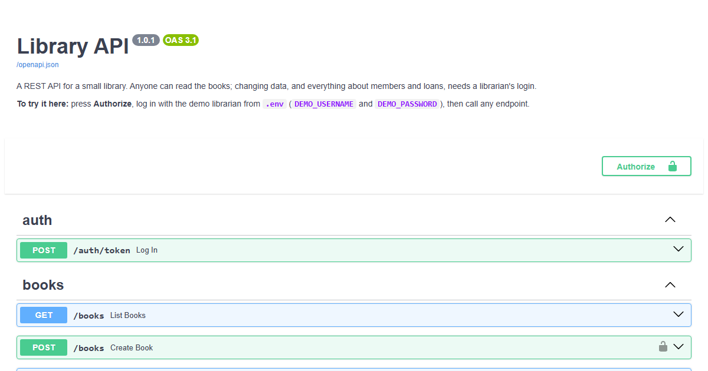

# [PROJECT TITLE]

[ONE-SENTENCE SUMMARY]

> This repository is the template for the portfolio projects. To start a project, copy it, then replace every value in square brackets, rename `src/project_name/`, and fill in `portfolio.json`.

## Demo



[LIVE DEMO LINK, or remove this line if the project is not hosted]

[Keep two or three result images in `docs/media/`: `thumbnail.png` (1200×630), the demo image, and one more that shows a result. Link the others here.]

## Core focus

[WHAT THIS PROJECT IS MEANT TO DEMONSTRATE]

## Skills demonstrated

- [SKILL]
- [SKILL]

## Quick start

No more than three commands, tested from a clean clone.

```bash
python -m venv .venv && .venv/Scripts/activate
```

```bash
pip install -e ".[dev]"
```

```bash
[COMMAND THAT RUNS THE PROJECT]
```

On macOS or Linux, activate the environment with `source .venv/bin/activate`.

### Run with Docker instead

If you have Docker, you do not need Python:

```bash
docker compose run --rm app
```

## How it works

[ARCHITECTURE OR PIPELINE, as bullets or a simple diagram]

## Results

[METRICS TABLE OR SCREENSHOTS]

## Tests

```bash
ruff check .
```

```bash
pytest
```

```bash
python scripts/validate_portfolio.py
```

## Limitations

- [LIMITATION]

## Considered improvements

- [NEXT STEP]

## License

MIT. See [LICENSE](LICENSE).
